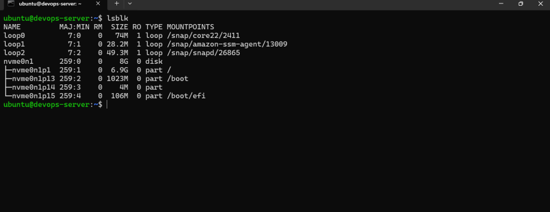
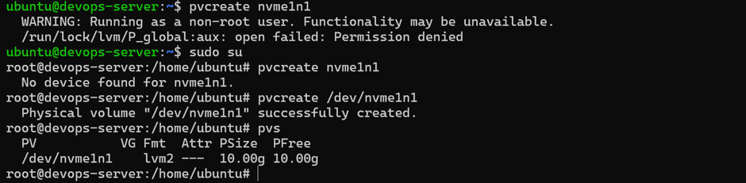
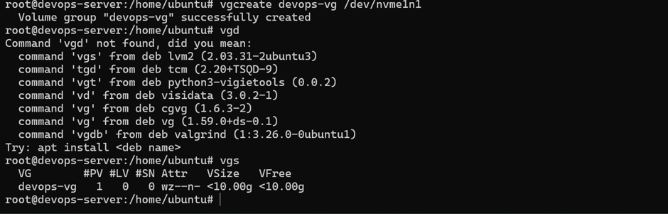
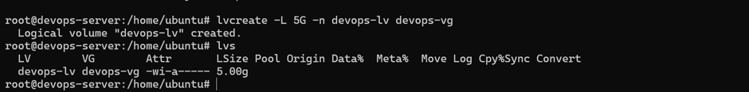
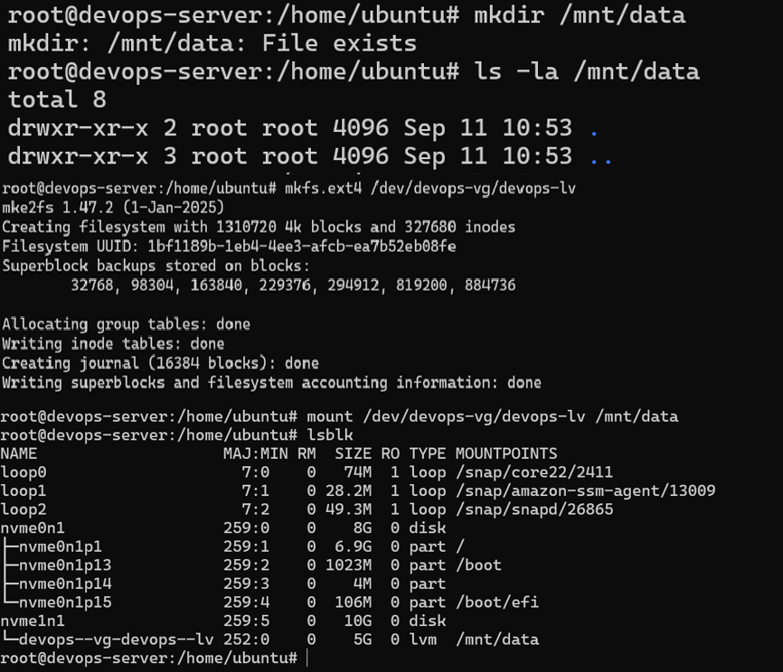
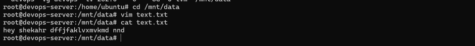
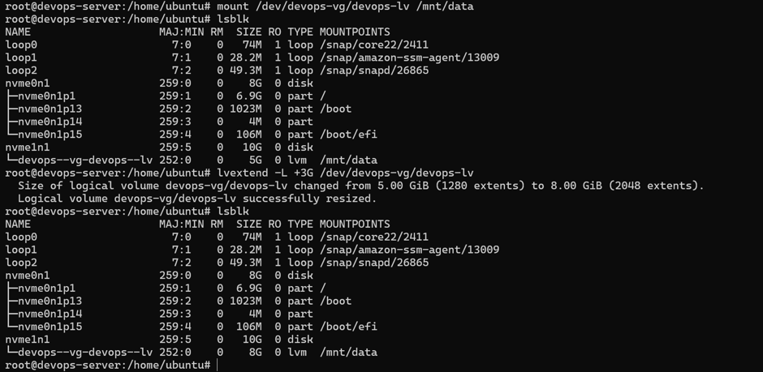

# Day 13 – Linux Volume Management (LVM)

## Objective

Learn how Linux Logical Volume Management (LVM) organizes storage and allows volumes to be created, mounted, and extended flexibly.

---

## Task 1: Check Current Storage

Run: `lsblk`, `pvs`, `vgs`, `lvs`, `df -h`

- `lsblk` – Lists block devices and partitions.
- `pvs` – Displays physical volumes.
- `vgs` – Displays volume groups.
- `lvs` – Displays logical volumes.
- `df -h` – Shows filesystem space usage.

**Screenshot:** Current storage information.


---

## Task 2: Verify Attached Volumes

Run: `lsblk`

**Screenshot:** Volume created and attached.


---

## Task 3: Create Physical Volume

```bash
pvcreate /dev/nvme1n1
pvs
```

- A **Physical Volume (PV)** is a disk or partition prepared for LVM.
- `pvcreate` initializes a device for use by LVM.
- `pvs` verifies the physical volume.

**Screenshot:** Physical volume creation.



---

## Task 4: Create Volume Group

```bash
vgcreate devops-vg /dev/nvme1n1
vgs
```

- A **Volume Group (VG)** combines physical volumes into a storage pool.
- `vgcreate` creates a new volume group.
- `vgs` displays volume group information.

**Screenshot:** Volume group creation.



---

## Task 5: Create Logical Volume

```bash
lvcreate -L 5G -n devops-lv devops-vg
lvs
```

- A **Logical Volume (LV)** is a virtual storage volume created from a volume group.
- `lvcreate` creates a logical volume with the specified size and name.
- `lvs` verifies the logical volume.

**Screenshot:** Logical volume creation.


---

## Task 6: Format and Mount the Volume

### Format the Logical Volume

```bash
mkfs.ext4 /dev/devops-vg/devops-lv
```
Created an ext4 filesystem on the logical volume `devops-lv`.

### Create the Mount Point

```bash
mkdir /mnt/data
```

The directory already existed, so the terminal displayed `File exists`. I verified the directory using:

```bash
ls -la /mnt/data
```

### Mount the Volume

```bash
mount /dev/devops-vg/devops-lv /mnt/data
```

Verify the mounted volume:

```bash
lsblk
```

The `lsblk` output showed the 5 GiB logical volume mounted at `/mnt/data`.

**Screenshot:** Format and Mount the Volume.



---

## Task 7: Create and Read a Test File

```bash
cd /mnt/data
vim text.txt
cat text.txt
```
Created text.txt and verified its contents.

**Screenshot:** Create & Read a File.



---

## Task 8: Extend the Volume

The volume extension still needs to be performed and verified.

### Extend the Volume

```bash
lvextend -L +3G /dev/devops-vg/devops-lv
```

This increases the logical volume size by 3G.

**Screenshot:** Extend the Volume.



---

## Additional LVM Inspection Commands

Run: `pvdisplay`, `vgdisplay`, `lvdisplay`

### Purpose
- `pvdisplay` - Shows detailed information about Physical Volumes (PV)
- `vgdisplay` - Shows detailed information about Volume Groups (VG)
- `lvdisplay` - Shows detailed information about Logical Volumes (LV)

These commands help verify LVM configuration, inspect storage allocation, and troubleshoot storage-related issues.


## What I Learned

- LVM uses physical volumes, volume groups, and logical volumes to manage storage.
- Logical volumes can be formatted, mounted, and used like other filesystems.
- Commands such as lsblk, pvs, vgs, and lvs help verify storage configuration.
- Mounted volumes can be used to store and access files.

