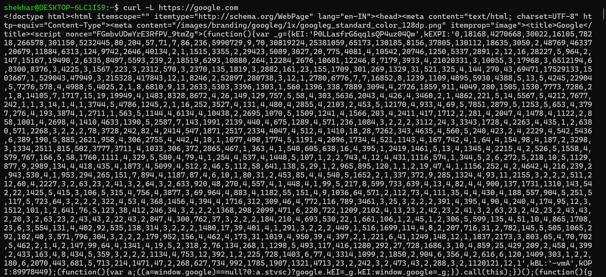
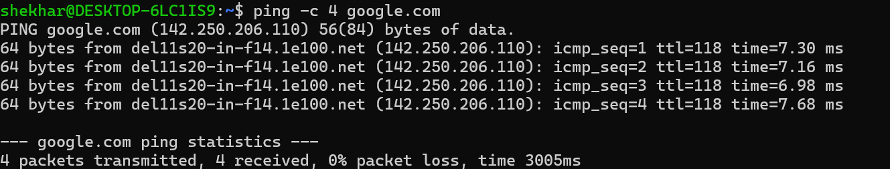
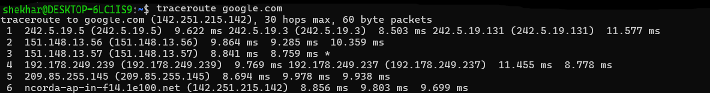
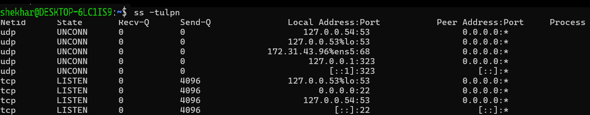
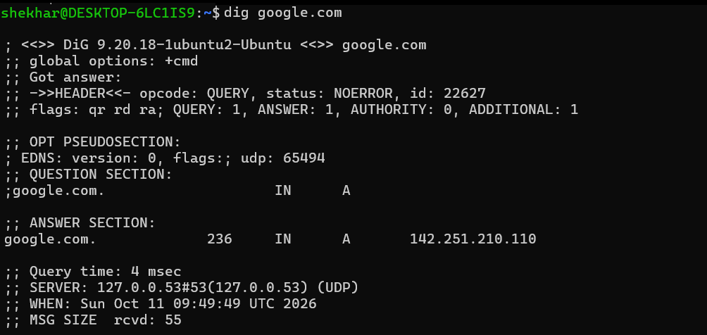
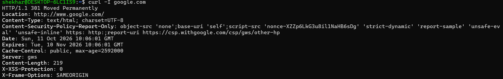
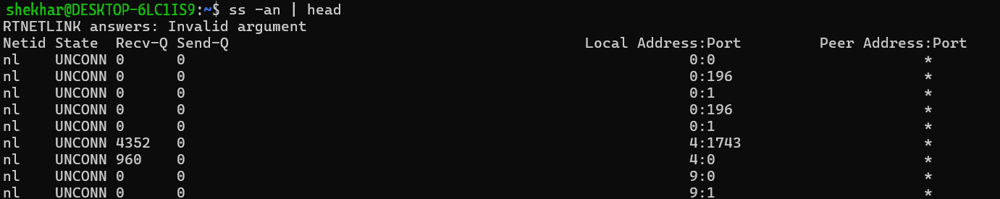
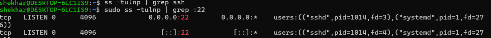

# Day 14 – Networking Fundamentals & Hands-on Checks

## Objective

Practice basic networking commands and understand how the OSI and TCP/IP models relate to real network troubleshooting.

---

# Part 1 – Networking Concepts

## OSI Model and TCP/IP Model

### OSI Model

The OSI model is a seven-layer framework used to understand network communication.

| Layer | Name | Purpose |
|------:|------|---------|
| 7 | Application | Provides network services to applications |
| 6 | Presentation | Handles data formatting, encryption, and compression |
| 5 | Session | Establishes and manages communication sessions |
| 4 | Transport | Provides TCP/UDP communication |
| 3 | Network | Manages IP addressing and routing |
| 2 | Data Link | Handles MAC addresses and frames |
| 1 | Physical | Handles physical transmission of bits (includes cables, signals, and networking hardware.) |

### TCP/IP Model

TCP/IP is a four-layer model used for communication across networks and the internet.

| TCP/IP Layer | Examples |
|--------------|----------|
| Application | HTTP, HTTPS, DNS, SSH |
| Transport | TCP, UDP |
| Internet | IP, ICMP |
| Link | Ethernet, Wi-Fi |

### Protocol Placement -

- **Application Layer** – HTTP, HTTPS, DNS, DHCP, SSH
- **Transport Layer** – TCP, UDP
- **Internet Layer** – IP, ICMP, ARP
- **Network Access Layer** – Ethernet, Wi-Fi

### Real Example
```bash
curl -L https://google.com
```

This command follows redirects and retrieves the response content.

Network flow: HTTP (Application) → TCP (Transport) → IP (Internet). 



---

# Part 2 – Hands-on Checklist 

## 1. Identity

**Command:**

```bash
hostname -I
```

**Observation:** Successfully identified the EC2 instance's private IP address: **172.31.79.114**.


---

## 2. Reachability

**Command:**
```bash
ping <target>
```

**Example:**
```bash
ping -c 4 google.com
```

By default, the ping command in Linux runs continuously until you manually stop it using Ctrl + C. Adding the -c flag (short for count) lets you specify an exact number of packets to transmit.

**Observation:** Successfully tested connectivity to Google. All packets were received with **0% packet loss** and an average latency of **7.280 ms**.



---

## 3. Network Path

**Command:**

```bash
traceroute <target>
```

**Example:**
```bash
traceroute google.com
```

**Observation:** Traffic reached Google successfully through multiple hops with low latency.



---

## 4. Listening Ports

**Command:**

```bash
ss -tulnp
```

**Observation:** Listed listening sockets and available process information. SSH was listening on **port 22**.



---

## 5. DNS Resolution

**Command:**

```bash
dig <domain>
```

**Example:**
```bash
dig google.com
```

**Observation:** The domain resolved to **142.251.210.110**, as shown in the captured output. DNS responses can vary by location and time.



---

## 6. HTTP Check

**Command:**

```bash
curl -I google.com
```

**Observation:** Received **HTTP/1.1 301 Moved Permanently**, redirecting the request to `www.google.com`.



---

## 7. Connection Snapshot

**Command:**

```bash
ss -an | head
```

**Observation:** Displayed a snapshot of socket and connection information.



---

# Mini Task: Port Probe & Interpret

- SSH service on port 22

## Check SSH Port

**Command:**

```bash
ss -tulnp
```

**Observation:** The SSH daemon (`sshd`) was listening on **port 22**.



## Test the Connection

**Command:**

```bash
nc -zv localhost 22
```

**Observation:** The connection to SSH on port 22 succeeded.


### If the Port Is Not Reachable

- Check service status: `systemctl status ssh`
- Review service logs: `journalctl -u ssh`
- Check firewall rules: `sudo ufw status`

---

# Reflection

- Ping command gives the fastest indication of network connectivity issues.
  -> `ping`

- DNS resolution confirms whether a domain name is correctly mapped to an IP address.
  -> `dig`, `nslookup`

- Traceroute helps identify the network path and potential delays between source and destination.
  -> `traceroute`

- HTTP checks verify web server availability and response status codes.
  -> `curl -I <url>`

- Port checks confirm whether a service is listening and reachable.
  -> `ss -tulnp`, `nc -zv`

## Follow-up Checks During an Incident

- Check firewall rules using `sudo ufw status`.
- Check service health using `systemctl status <service>`.
- Review service logs using `journalctl -u <service>`.
- Test connectivity using `ping`, `traceroute`, and `nc`.


