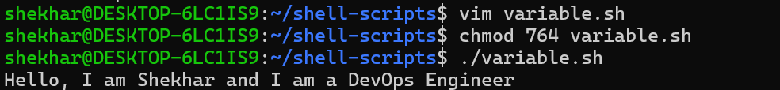
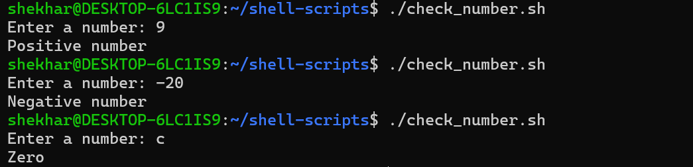
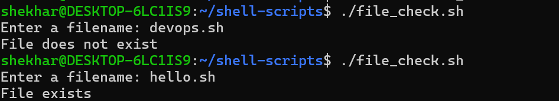
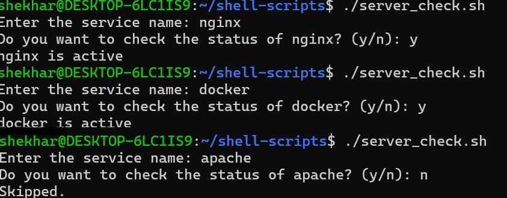

# Day 16 – Shell Scripting Basics

## Objective

Learn shell scripting fundamentals using the shebang, variables, user input, conditional statements, and basic service checks.

---

# Task 1 – Your First Script

1. Create a file `hello.sh`
2. Add the shebang line `#!/bin/bash` at the top
3. Print `Hello, DevOps!` using `echo`
4. Make it executable and run it

**Output:**


**What is a shebang?**
- `#!/bin/bash` tells the system to run the script using Bash.
- Without the shebang, direct execution may fail or use a different interpreter, depending on the environment.

---

# Task 2 – Variables

1. Create `variables.sh` with:
   - A variable for your NAME
   - A variable for your ROLE (e.g. "DevOps Engineer")
   - Print: `Hello, I am <NAME> and I am a <ROLE>`

**Output:**



2. Try using single quotes vs double quotes — what's the difference?

- Double quotes `" "` allow variable expansion.
- Single quotes `' '` treat the content as literal text.

---

# Task 3 – User Input with `read`

1. Create `greet.sh` that:
   - Asks the user for their name using `read`
   - Asks for their favourite tool
   - Prints: `Hello <name>, your favourite tool is <tool>`

**Output:**


---

# Task 4 – If-Else Conditions

1. Create `check_number.sh` that:
   - Takes a number using `read`
   - Prints whether it is positive, negative, or zero

### Script

```bash
#!/bin/bash

read -p "Enter a number: " number


if [ $number -gt 0 ]; then
	echo "The number is Positive."
elif [ $number -lt 0 ]; then
	echo "The number is Negative."
else
	echo "The number is Zero."
fi
```

**Output:**



2. Create `file_check.sh` that:
   - Asks for a filename
   - Checks if the file exists using `-f`
   - Prints appropriate message

### Script
```bash
#!/bin/bash

read -p "Enter a filename: " File

if [ -f "$File" ]; then
    echo "File exists"
else
    echo "File does not exist"
fi
```

**Output:**



The result depends on whether the specified file actually exists.

---

# Task 5 – Combine It All: Service Check

Create `server_check.sh` that:

1. Stores a service name in a variable (e.g., `nginx`, `sshd`)
2. Asks the user: "Do you want to check the status? (y/n)"
3. If `y` — runs `systemctl status <service>` and prints whether it's active or not
4. If `n` — prints "Skipped."

### Script
```bash
#!/bin/bash

read -p "Enter the service name: " service
read -p "Do you want to check the status of $service? (y/n): " answer

if [[ "$answer" == "y" ]]; then
    if systemctl is-active $service > /dev/null; then
        echo "$service is active"
    else
        echo "$service is not active"
    fi
elif [[ "$answer" == "n" ]]; then
    echo "Skipped."
else
    echo "Invalid choice. Enter y or n."
fi
```

**Output**



---

# What I learned 

- How to write and execute Bash scripts using `#!/bin/bash`.
- Working with variables and variable expansion.
- Taking user input using the `read` command.
- Understanding the difference between single and double quotes.
- Using conditional statements (`if`, `elif`, `else`) in Bash.
- Checking file existence using the `-f` operator.
- Verifying service status using `systemctl is-active`.
- Making scripts executable using `chmod +x`.

---

