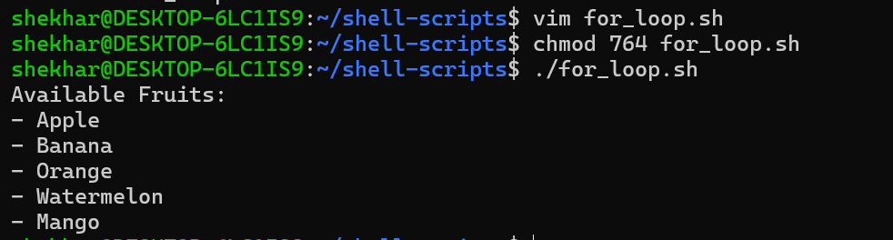
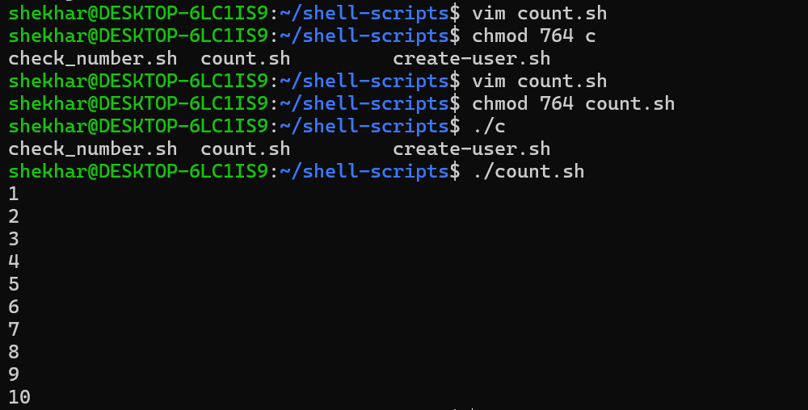
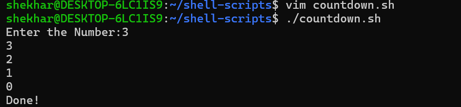
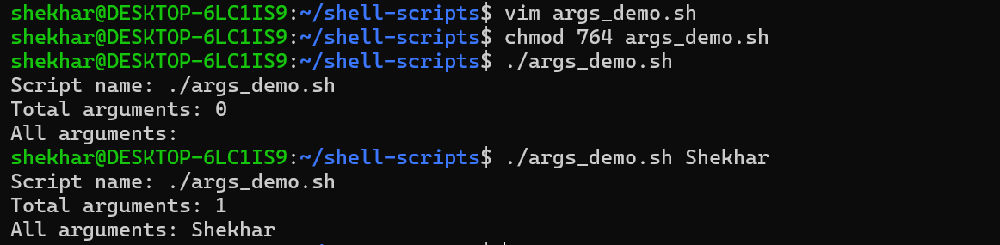
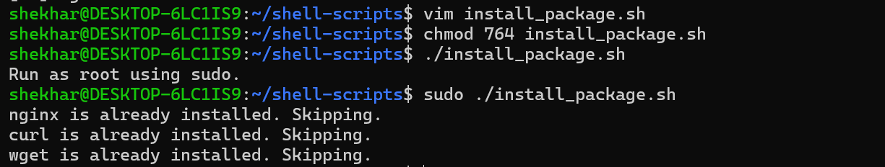
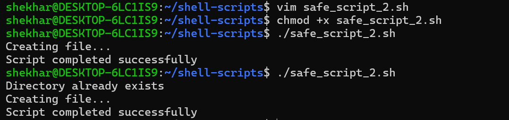

# Day 17 – Shell Scripting: Loops, Arguments & Error Handling

## Objective

Learn how to use loops, command-line arguments, package installation, and error handling to automate Linux administration tasks.

---

# Task 1 – For Loop

## 1. Create `for_loop.sh`
- Loops through a list of fruits
- Prints each fruit using a for loop

### Scripts 
```bash
#!/bin/bash

fruits=("apple" "banana" "orange" "grape" "mango")

for fruit in "${fruits[@]}"
do
    echo "$fruit"
done
```

**Output:**


## 2. Create `count.sh`

- Prints numbers 1 to 10 using a for loop

### Scripts 
```bash
#!/bin/bash

for number in {1..10}; do
    echo "$number"
done
```

**Output:** 



**What I learned:** A `for` loop repeats commands for each item in a list.

---

# Task 2 – While Loop

## Create `countdown.sh`

- Takes a number from the user
- Counts down to 0 if positive
- Counts up to 0 if negative
- Prints "Done!" at the end
- Validates user input

### Scripts

```bash
#!/bin/bash

read -p "Enter a number: " number

while [ "$number" -ge 0 ]; do
    echo "$number"
    ((number--))
done

echo "Done!"
```

**Output:**




**What I learned:** A `while` loop continues executing as long as its condition is true.

---

# Task 3 – Command-Line Arguments

## 1. Create `greet.sh`

- Accepts a name as `$1`
- Prints `Hello, <name>!`
- Shows usage message if no argument is passed

```bash
#!/bin/bash

if [ "$#" -eq 0 ]; then
    echo "Usage: ./greet.sh <name>"
    exit 1
fi

echo "Hello, $1!"
```

**Output:**


## 2. Create `args_demo.sh`

- Prints total number of arguments (`$#`)
- Prints all arguments (`$@`)
- Prints script name (`$0`)

```bash
#!/bin/bash

echo "Script name: $0"
echo "Total arguments: $#"
echo "All arguments: $@"
```

**Output:**



**What I learned:**

- `$0` represents the script name.
- `$1` represents the first argument.
- `$#` gives the number of arguments.
- `"$@"` represents all arguments while preserving their individual boundaries.

---

# Task 4 – Install Packages via Script


- Defines a package list (`nginx`, `curl`, `wget`)
- Checks whether packages are installed
- Installs missing packages
- Displays package status

## Create `install_packages.sh`

```bash
#!/bin/bash

if [ "$EUID" -ne 0 ]; then
    echo "Run as root using sudo."
    exit 1
fi

packages=(nginx curl wget)

for package in "${packages[@]}"; do
    if dpkg -s "$package" &>/dev/null; then
        echo "$package is already installed. Skipping."
    else
        echo "Installing $package..."

        if apt-get install -y "$package"; then
            echo "$package installed successfully."
        else
            echo "Failed to install $package."
        fi
    fi
done
```

**Example output:**



**What I learned:**

- `dpkg -s` checks whether a Debian package is installed.
- `apt-get install -y` installs a package without interactive confirmation.
- A loop can automate package checks and installations.

---

# Task 5 – Error Handling

## Create `safe_script.sh`

```bash
#!/bin/bash

set -e

mkdir /tmp/devops-test 2>/dev/null || {
	echo "Directory already exists"
}

cd /tmp/devops-test || {
	echo "Failed to enter directory"
        exit 1

}

echo "Creating file..."

> demo.txt 2>/dev/null || {
	echo "demo.txt already exists"
}

echo "Script completed successfully"

```

**Output:**



---

## Key Learnings

- Learned `for` and `while` loops in Bash
- Practiced command-line arguments (`$1`, `$#`, `$@`, `$0`)
- Automated package installation
- Checked package status using `dpkg -s`
- Implemented root-user validation using `$EUID`
- Applied error handling techniques in shell scripts
- Improved Bash scripting and troubleshooting skills