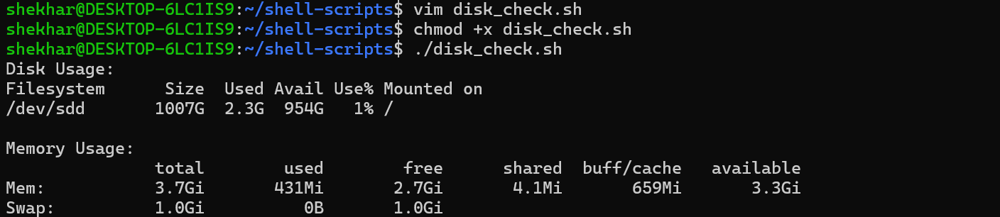
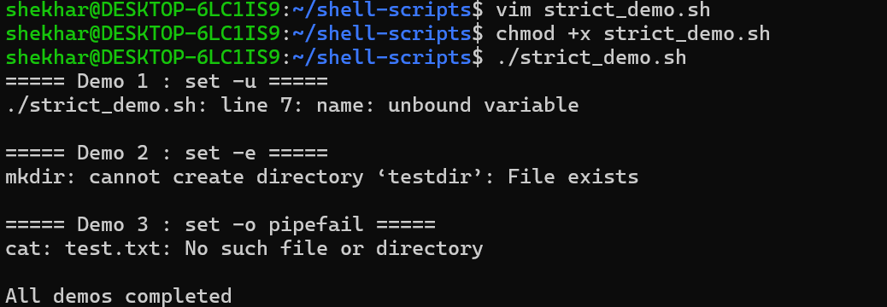
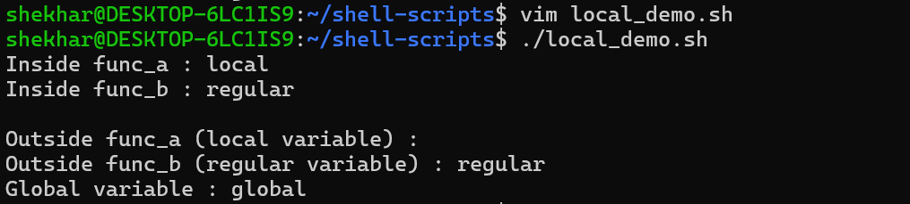
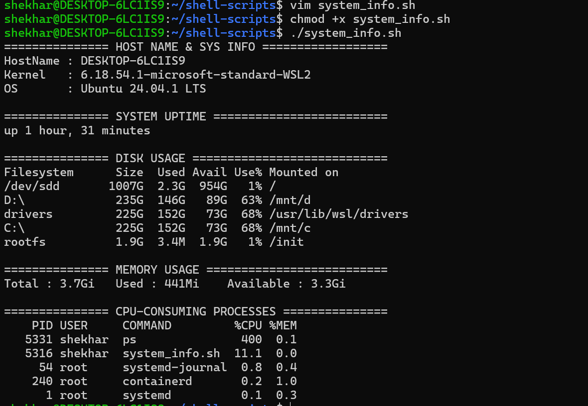

 
# Day 18 – Shell Scripting: Functions & Intermediate Concepts

## Objective

Learn how to write reusable Bash functions, use local variables, handle return values, and make scripts safer with strict mode.

---

## Task 1 – Basic Functions

## Create `functions.sh`: 
   - A function `greet` that takes a name as argument and prints `Hello, <name>!`
   - A function `add` that takes two numbers and prints their sum
   - Call both functions from the script

### Scripts 

```bash
#!/bin/bash

greet() {
    name="$1"
    echo "Hello, $name!"
}

add() {
    local sum=$(( $1 + $2 ))
    echo "Sum: $sum"
}

greet "Shekhar"
add 10 20
```

**Output:**


---

## Task 2 – Functions with Return Values

## Create `disk_check.sh`

- A function `check_disk` that checks disk usage of `/`
- A function `check_memory` that checks available memory
- A main section that calls both functions and prints the results

### Scripts 

```bash
#!/bin/bash

check_disk() {
    echo "Disk Usage:"
    df -h /
}

check_memory() {
    echo "Memory Usage:"
    free -h
}

main() {
    check_disk
    echo
    check_memory
}

main

```

**Output:**



---

## Task 3 – Strict Mode

## Create `strict_demo.sh` with `set -euo pipefail` at the top
Demonstrate:
   - Undefined variable using `set -u`
   - Failed command using `set -e`
   - Failed pipeline using `set -o pipefail`

### What does each flag do?

- `set -e` → Exit immediately if a command fails.
- `set -u` → Exit if an undefined variable is used.
- `set -o pipefail` → Makes a pipeline fail if any command in the pipeline fails.

### Scripts 

```bash
#!/bin/bash

echo "===== Demo 1 : set -u ====="

(
    set -u
    echo "$name"
)

echo ""

echo "===== Demo 2 : set -e ====="

(
    set -e
    mkdir testdir
    mkdir testdir
)

echo ""

echo "===== Demo 3 : set -o pipefail ====="

(
    set -o pipefail
    cat test.txt | grep "Hello"
)

echo ""
echo "All demos completed"

```

**Output:**




---

## Task 4 – Local Variables

## Create `local_demo.sh`

- A function that uses the `local` keyword for variables
- Show that local variables do not leak outside the function
- Compare local variables with regular variables

### Scripts 

```bash
#!/bin/bash

name="global"

func_a() {
	local local_name="local"
	echo "Inside func_a : $local_name"
}

func_b() {
	regular_name="regular"
	echo "Inside func_b : $regular_name"
}

func_a
func_b

echo ""

echo "Outside func_a (local variable) : $local_name"
echo "Outside func_b (regular variable) : $regular_name"
echo "Global variable : $name"

```

**Output:**



### Understanding Local Variables

- `local` creates a variable available only inside the function and its nested calls.
- A regular variable assigned inside a function is generally available outside it.
- Using `local` helps avoid accidentally changing variables elsewhere in a script.


---

## Task 5 – System Info Reporter

## Create `system_info.sh` that uses functions for everything:

1. A function to print hostname and OS information

2. A function to print system uptime

3. A function to print disk usage

4. A function to print memory usage

5. A function to print top CPU-consuming processes

6. A main function that calls all the above functions

7. Use `set -euo pipefail` at the top

### Scripts 

```bash
#!/bin/bash

set -euo pipefail

sys_info() {
    echo "=============== HOST NAME & SYS INFO =================="
    echo "HostName : $(hostname)"
    echo "Kernel   : $(uname -r)"
    echo "OS       : $(grep PRETTY_NAME /etc/os-release | cut -d= -f2 | tr -d '"')"
}

sys_uptime() {
    echo -e "\n=============== SYSTEM UPTIME ========================="
    uptime -p
}

disk_usage() {
    echo -e "\n=============== DISK USAGE ============================"
    df -h | awk 'NR==1'
    df -h | sort -hr -k2 | head -5
}

mem_usage() {
    echo -e "\n=============== MEMORY USAGE =========================="
    free -h | awk 'NR==2{print "Total : "$2,"\tUsed : "$3,"\tAvailable : "$7}'
}

cpu_consuming_processes() {
    echo -e "\n=============== CPU-CONSUMING PROCESSES ==============="
    ps -eo pid,user,comm,%cpu,%mem --sort=-%cpu | head -n 6
}

main() {
    sys_info
    sys_uptime
    disk_usage
    mem_usage
    cpu_consuming_processes
}

main

```

**Output:**



---

# What I Learned

1. Functions make scripts reusable, organized, and easier to maintain.
2. `local` variables help prevent unwanted changes to variables outside a function.
3. Strict mode (`set -euo pipefail`) helps detect errors and makes scripts safer.
4. Command substitution can capture output from functions and commands.
5. Functions can combine Linux commands to build useful automation tools.

---

