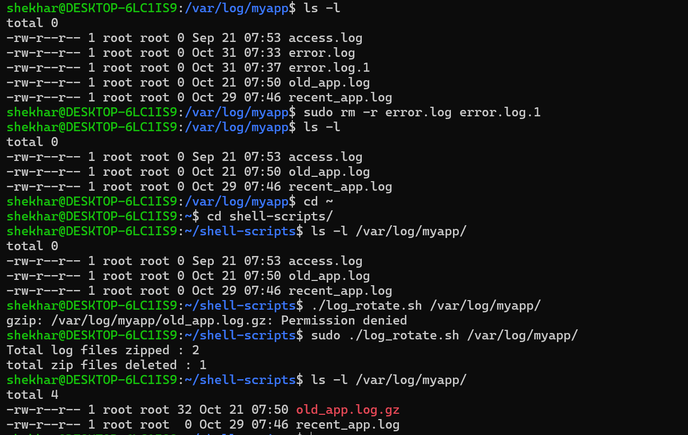
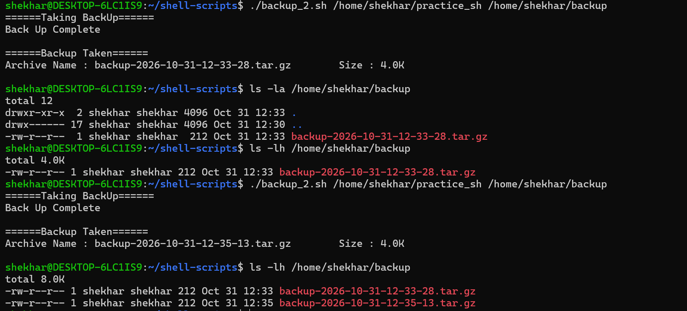

# Day 19 – Shell Scripting Project: Log Rotation, Backup & Crontab

## Objective

Apply Bash scripting concepts by automating log rotation, server backups, and scheduled maintenance using cron.

---

# Task 1 – Log Rotation Script

## Create `log_rotate.sh`

1. Takes a log directory as an argument (e.g., `/var/log/myapp`)
2. Compresses `.log` files older than 7 days using `gzip`
3. Deletes `.gz` files older than 30 days
4. Prints how many files were compressed and deleted
5. Exits with an error if the directory doesn't exist

### Script

```bash
#!/bin/bash

set -eu

usage() {
	echo "Usage: ./log_rotate.sh /var/log/app_name"
	echo "Example: ./log_rotate.sh /var/log/apache2"
	exit 1
}

if [ "$#" -eq 0 ]; then
	usage
fi

dir=$1

check_dir() {
	[ -d "$dir" ] || {
		echo "Directory $dir does not exists"
	        exit 1
}
}

gzip_count=0
delete_count=0

compress() {
	file_list=$(find "$dir" -type f -name "*.log" -mtime +7)

	for file in $file_list; do
		gzip "$file"
		gzip_count=$((gzip_count + 1))
	done
}

delete_log() {
	zip_files=$(find "$dir" -type f -name "*.gz" -mtime +30)

	for file in $zip_files; do
		rm "$file"
		delete_count=$((delete_count + 1))
	done
}

check_dir
compress
delete_log

echo "Total log files zipped : $gzip_count"
echo "total zip files deleted : $delete_count"

```

Run the script:

```bash
chmod +x log_rotate.sh
./log_rotate.sh /var/log/myapp
```

**Output:**



---

# Task 2 – Server Backup Script

## Create `backup.sh`

1. Takes a source directory and backup destination as arguments
2. Creates a timestamped `.tar.gz` archive (e.g., `backup-2026-06-15.tar.gz`)
3. Verifies the archive was created successfully
4. Prints archive name and size
5. Deletes backups older than 14 days from the destination
6. Handles errors — exit if source doesn't exist


```bash
#!/bin/bash

set -eu

usage() {
    echo "Usage : backup.sh source/path destination/path"
    echo "Example : backup.sh /home/ubuntu/practice_sh /home/ubuntu/backup"
    echo "Please provide source and destination"
    exit 1
}

check_source() {
    [ -d "$src" ] || {
        echo "Source directory doesn't exist"
        exit 1  
    }

    [ -d "$dest" ] || {
        echo "Destination directory doesn't exist"
        exit 1
    }
}

timestamp=$(date +%Y-%m-%d-%H-%M-%S)
archive="backup-${timestamp}.tar.gz"

backup() {

    echo "======Taking BackUp======"

    tar -czf "$dest/$archive" "$src" &>/dev/null

    echo "Back Up Complete"
    echo
}

print_file() {

    echo "======Backup Taken======"

    size=$(du -sh "$dest/$archive" | awk '{print $1}')

    echo "Archive Name : $archive        Size : $size"
    echo
}

delete_old_archives() {

    archives=$(find "$dest" -name "*.tar.gz" -mtime +14)

    if [ -n "$archives" ]; then

        echo "======Removing archives older than 14 days======"

        for file in $archives
        do
            rm "$file"
            echo "Removed Archive : $file"
        done
    fi
}

if [ $# -lt 2 ]; then
    usage
fi

src=$1
dest=$2

check_source
backup
print_file
delete_old_archives
```

Run the script:

```bash
chmod +x backup.sh
./backup_2.sh /home/ubuntu/practice_sh /home/ubuntu/backup
```

**Output:**



---

# Task 3 – Crontab

1. Read: `crontab -l` — what's currently scheduled?

2. Understand cron syntax:

```text
* * * * *  command
| | | | |
| | | | +---- Day of week (0-7)
| | | +------ Month (1-12)
| | +-------- Day of month (1-31)
| +---------- Hour (0-23)
+------------ Minute (0-59)
```

3. Cron entries for:

- Run `log_rotate.sh` every day at 2 AM

```bash
0 2 * * *
```

- Run `backup.sh` every Sunday at 3 AM

```bash
0 3 * * 0
```

- Run a health check script every 5 minutes

```bash
*/5 * * * *
```

---

# Task 4 – Scheduled Maintenance Script

## Create `maintenance.sh`
1. Calls your log rotation function
2. Calls your backup function
3. Logs all output to `/var/log/maintenance.log` with timestamps
4. Write the cron entry to run it daily at 1 AM:

```bash
0 1 * * *
```

```bash
#!/bin/bash

set -eu

LOG_FILE="/var/log/maintenance.log"

log_rotation() {
    /home/ubuntu/90DaysOfDevOps/2026/day-19/scripts/log_rotate.sh \
    /var/log/demo >> "$LOG_FILE" 2>&1
}

backup() {
    /home/ubuntu/90DaysOfDevOps/2026/day-19/scripts/backup.sh \
    /home/ubuntu/practice_sh \
    /home/ubuntu/backup >> "$LOG_FILE" 2>&1
}

main() {

    echo "" >> "$LOG_FILE"
    echo "$(date) : Starting Maintenance..." >> "$LOG_FILE"

    log_rotation
    backup

    echo "Maintenance completed for today" >> "$LOG_FILE"
}

main

echo "Successfully written logs to $LOG_FILE"

```

Run the script:

```bash
chmod +x maintenance.sh
sudo ./maintenance.sh
```

Check the maintenance log:

```bash
sudo tail -n 30 /var/log/maintenance.log
```

**Example log output:**

```text
[2026-10-30 21:00:00] Starting scheduled maintenance.
[2026-10-30 21:00:00] Starting log rotation.
[2026-10-30 21:00:01] Log rotation completed.
[2026-10-30 21:00:01] Starting server backup.
[2026-10-30 21:00:05] Backup created successfully.
[2026-10-30 21:00:05] Scheduled maintenance completed.
```

---

## What I learned

- Learned how to automate log rotation using Shell Scripting.
- Used `find` with `-mtime` to identify old files.
- Compressed log files using `gzip`.
- Created timestamp-based backups using `tar`.
- Removed old backup archives automatically.
- Learned cron scheduling and cron syntax.
- Combined multiple scripts into a maintenance workflow.
- Logged script output to a maintenance log file.
- Improved Shell Scripting and Linux automation skills.


