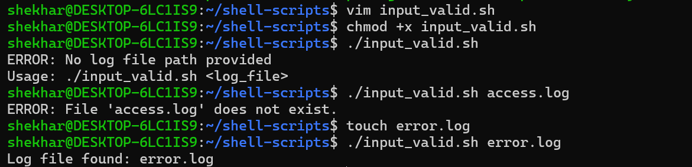
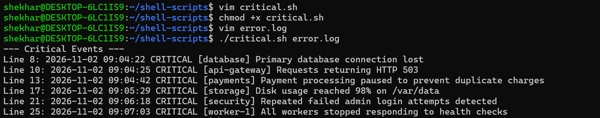
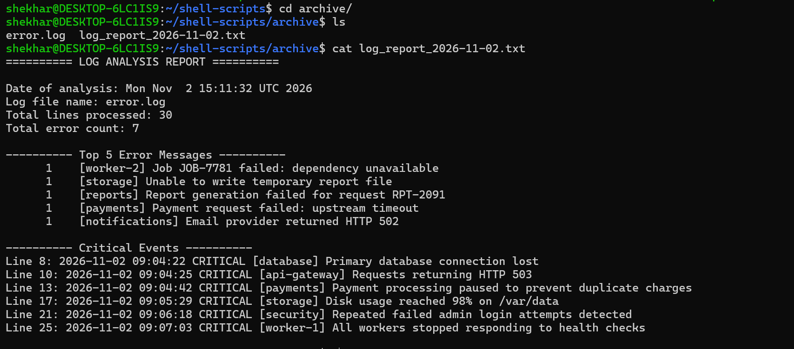

# Day 20 – Bash Scripting Challenge: Log Analyzer and Report Generator

## Objective

Build a Bash script that analyzes log files, identifies errors and critical events, finds common error messages, and generates a daily summary report.

---

# Task 1 – Input and Validation

Your script should:

1. Accept the path to a log file as a command-line argument
2. Exit with a clear error message if no argument is provided
3. Exit with a clear error message if the file doesn't exist

### Create log_analyzer.sh

### Script 
```bash
#!/bin/bash

set -euo pipefail
# Check if argument is provided

if [ $# -eq 0 ]; then
	echo "ERROR: No log file path provided"
	echo "Usage: $0 <log_file>"
	exit 1
fi

log_file=$1

# Check if file exists

if [ ! -f "$log_file" ]; then
	echo "ERROR: File '$log_file' does not exist."
	exit 1
fi

echo "Log file found: $log_file"
```
- This validates the input before processing the log file.

**Output**



---

# Task 2 – Error Count

1. Count the total number of lines containing the keyword `ERROR` or `Failed`
2. Print the total error count to the console

### Add the following to the script:

```bash
# Count lines containing ERROR or Failed
error_count=$(grep -E "ERROR|Failed" "$log_file" | wc -l)

# Print the total error count
echo "Total Error Count: $error_count"
```

- This counts lines containing either `ERROR` or `Failed`.
- `grep` searches the log file for specific patterns.

- `-E` allows multiple patterns.
- `-i` makes the search case-insensitive.

**Output**


---

# Task 3 – Critical Events

1. Search for lines containing the keyword `CRITICAL`
2. Print those lines along with their line number

```bash
echo
echo "--- Critical Events ---"

if grep -n 'CRITICAL' "$LOG_FILE"; then
    :
else
    echo "No critical events found."
fi
```

- The `-n` option displays line numbers along with matching log entries.

**Output**



---

# Task 4 – Top 5 Error Messages

1. Extract all lines containing `ERROR`
2. Identify the top 5 most common error messages
3. Display them with their occurrence count sorted in descending order

```bash
echo "--- Top 5 Error Messages ---"

grep "ERROR" "$log_file" |
awk '{$1=$2=$3=""; print}' |
sort |
uniq -c |
sort -rn |
head -5
```
**Output**


**What I learned:**

- `grep` extracts lines containing `ERROR`.
- `awk` Removes the first three fields so the remaining text represents the `ERROR` message.
- `sort` groups identical messages together.
- `uniq -c` counts repeated messages.
- `sort -nr` sorts counts in descending numerical order.
- `head -5` displays the five most common messages.

---

# Task 5 – Generate Summary Report

Generate a summary report containing:

1. Date of analysis
2. Log file name
3. Total lines processed
4. Total error count
5. Top 5 error messages
6. Critical events with line numbers

### Script `log_analyzer.sh`

```bash
#!/bin/bash

set -euo pipefail

# Validate input
if [ $# -eq 0 ]; then
    echo "Error: No log file path provided."
    exit 1
fi

log_file="$1"

if [ ! -f "$log_file" ]; then
    echo "Error: File does not exist: $log_file"
    exit 1
fi

# Create archive directory if it doesn't exist
mkdir -p archive

# Date
analysis_date=$(date)

# Total lines
total_lines_processed=$(wc -l < "$log_file")

# Total errors
total_errors_count=$(grep -Ei "ERROR|Failed" "$log_file" | wc -l)

# Top 5 error messages
top_errors=$(grep "ERROR" "$log_file" \
| awk '{$1=$2=$3=""; print}' \
| sort \
| uniq -c \
| sort -rn \
| head -5)

# Critical events with line numbers
critical_events=$(grep -n "CRITICAL" "$log_file" | while IFS=: read -r line_num log_entry
do
    echo "Line $line_num: $log_entry"
done)

# Report file (inside archive folder)
report_file="archive/log_report_$(date +%F).txt"

{
    echo "========== LOG ANALYSIS REPORT =========="
    echo
    echo "Date of analysis: $analysis_date"
    echo "Log file name: $log_file"
    echo "Total lines processed: $total_lines_processed"
    echo "Total error count: $total_errors_count"
    echo

    echo "---------- Top 5 Error Messages ----------"
    echo "$top_errors"
    echo

    echo "---------- Critical Events ----------"
    echo "$critical_events"
    echo

} > "$report_file"

echo "Summary report generated: $report_file"

# Move processed log file to archive
mv "$log_file" archive/

echo "Moved $log_file to archive/"
echo "Log analysis completed."

```
---

### Run the Script

Make it executable:

```bash
chmod +x log_analyzer.sh
```

Run it against the sample log:

```bash
./log_analyzer.sh error.log
```

**Output**




---

## Commands Used

| Command | Purpose |
|---|---|
| `grep` | Searches for matching log entries |
| `grep -n` | Displays matching lines with line numbers |
| `awk` | Parse log entries and extract meaningful information. |
| `sort` | Sorts messages |
| `uniq -c` | Counts repeated messages |
| `head -5` | Displays the top five results |
| `wc -l` | Counts total lines |
| `date` | Generates the report date |
| `mkdir -p` | Creates the archive directory |
| `mv` | Moves processed log files |
| `set -euo pipefail` | Enables Bash strict mode |

---

## What I Learned

- How to validate user input in Bash scripts.
- How to search and filter log files using `grep`.
- How to count occurrences using `wc`, `sort`, and `uniq`.
- How to extract and analyze log data using `awk`.
- How to generate structured reports automatically.
- How to archive processed log files for better organization.
- How to combine multiple Bash scripts into a complete log analysis workflow.

---
