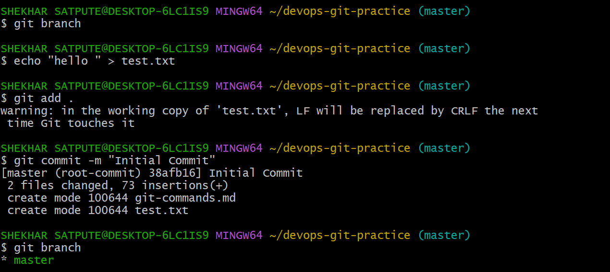
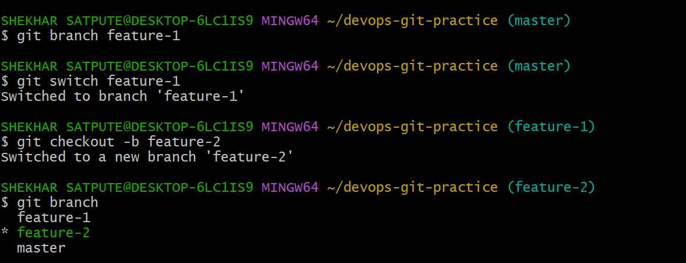
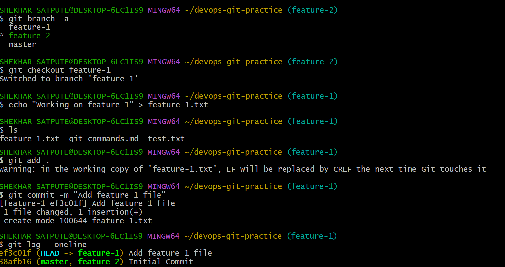
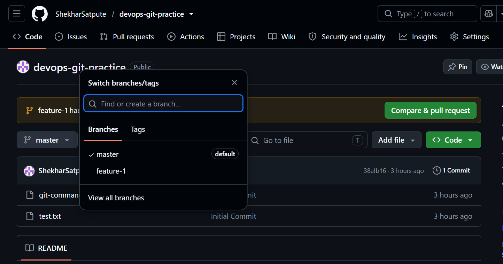
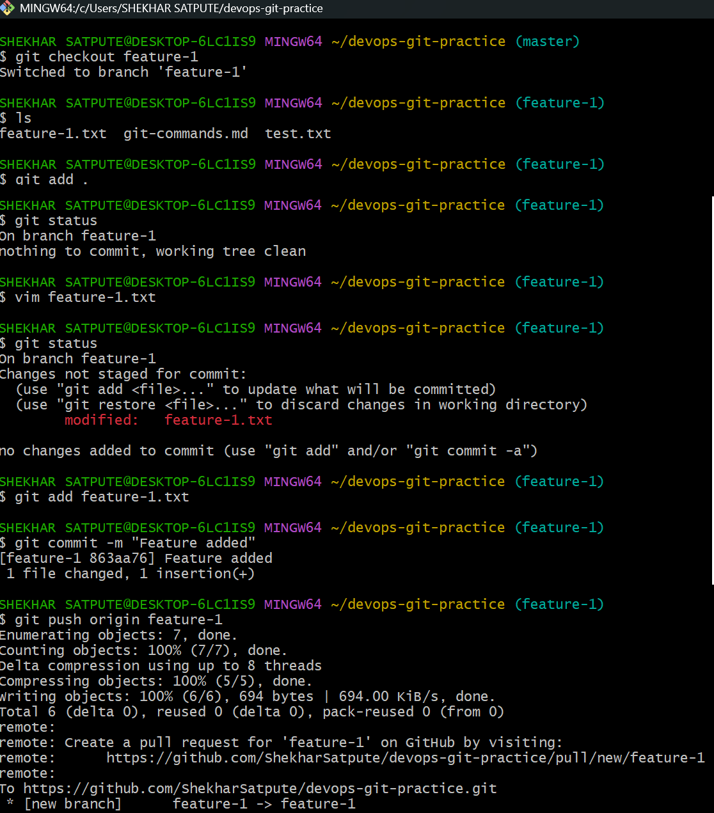

# Day 23 – Git Branching & Working with GitHub

## Objective

Learn Git branching, work with multiple branches, push a local repository to GitHub, and understand remote repositories, fetching, pulling, cloning, and forking.

---

# Task 1 – Understanding Branches

## 1. What is a branch in Git?

- A branch is a separate workspace used to make changes without affecting the main project.
- A branch points to a commit in Git history.
For example:

```text
main
 |
 └── feature-1
```


## 2. Why do we use branches instead of committing everything to `main`?

- Branches help keep the main code stable while allowing developers to work independently. 
- Changes can be tested and reviewed before merging into `main`.


## 3. What is `HEAD` in Git?

- `HEAD` points to the latest commit in the current branch.
- Example:
```text
HEAD -> feature-1
```
means I am currently working on `feature-1`.

## 4. What happens to files when switching branches?

- Git updates your working directory to match the selected branch.
  - Untracked files remain unchanged.
  - Tracked files change according to the branch.
  - Uncommitted changes may block switching.
  - Changes committed on one branch may not be visible when I switch to another branch.

---

# Task 2 – Branching Commands: Hands-On

1. List all branches in your repo

2. Create a new branch called `feature-1`

3. Switch to `feature-1`

4. Create a new branch and switch to it in a single command — call it `feature-2`

5. Try using `git switch` to move between branches — how is it different from `git checkout`?

6. Make a commit on `feature-1` that does not exist on `main`

7. Switch back to `main` — verify that the commit from `feature-1` is not there

8. Push your branches to GitHub

9. Verify both branches are visible on GitHub

Run these commands inside `devops-git-practice`.







---

# Task 3 – Push to GitHub

1. Create a new repository named `devops-git-practice` on GitHub (do NOT initialize it with a README)

2. Connect your local `devops-git-practice` repo to the GitHub remote

3. Push your `main` branch to GitHub

4. Push `feature-1` branch to GitHub

5. Verify both branches are visible on GitHub

6. What is the difference between `origin` and `upstream`?

- `Origin` - Points to your remote repository.
- `Upstream` - Points to the repository you forked from.
  - If not forked then no need of upstream.





---

# Task 4 – Pull from GitHub

## 1. Make a Change on GitHub

- Open your `devops-git-practice` repository on GitHub.
- Open `git-commands.md`.
- Add a small section or a new command using the GitHub editor.
- Commit the change directly to the `main` branch.

## 2. Pull the Change Locally

Switch to `main`:

```bash
git switch main
```

Pull the latest changes:

```bash
git pull origin main
```

Verify the updated file:

```bash
git status
git log --oneline
```

## 3. Difference Between git fetch and git pull

| Command | Purpose |
|---|---|
| `git fetch` | Only downloads changes from the remote. It does not merge them into your local branch. |
| `git pull` | Downloads the changes and merges them into your local branch. |

---

# Task 5 – Clone vs Fork

1. Clone any public repository from GitHub to your local machine

2. Fork the same repository on GitHub, then clone your fork

## 3. Difference Between Clone and Fork

| Clone | Fork |
|---|---|
| Creates a local copy of a repository. | Creates a server-side copy under your GitHub account. |
| Uses the `git clone` command. | Uses the GitHub Fork option. |
| Used to work with a repository locally. | Used to contribute independently to another repository. |

## 4. When Would I Clone vs Fork?

- **Clone:** When I want to download a repository and work with it locally.
- **Fork:** When I want my own GitHub copy of another person's repository, usually to make changes and contribute through a pull request.

### When would you clone vs fork?

- I will fork a repository from publicly available repos into my GitHub account and use it.

- I will clone if I want a local copy of a repository. I can work on it freely.

### After forking, how do you keep your fork in sync with the original repo?

- There is an option available on GitHub, **Sync Fork**.

- You can update a fork using that option.

---

# What I Learned

1. Git branches allow me to work on features independently without directly changing the main branch.
2. GitHub remotes allow me to push and pull changes between my local repository and GitHub.
3. Forking and cloning are useful for collaborating on open-source projects and maintaining my own copy of a repository.

---
