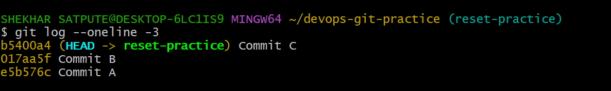
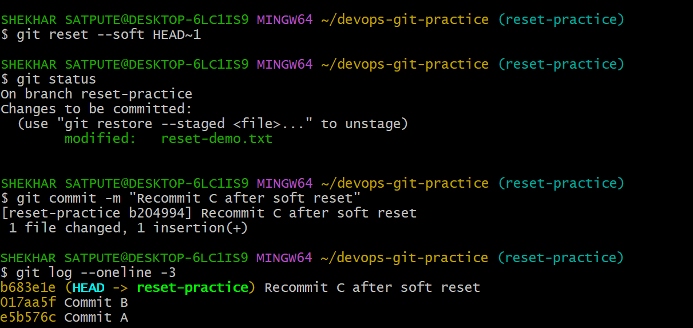
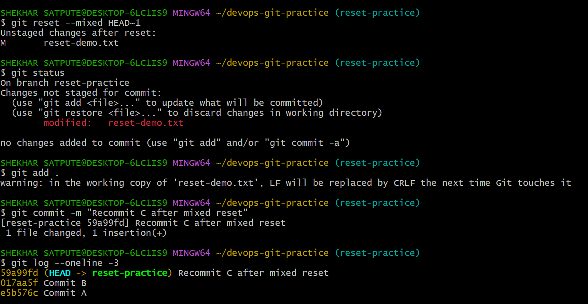
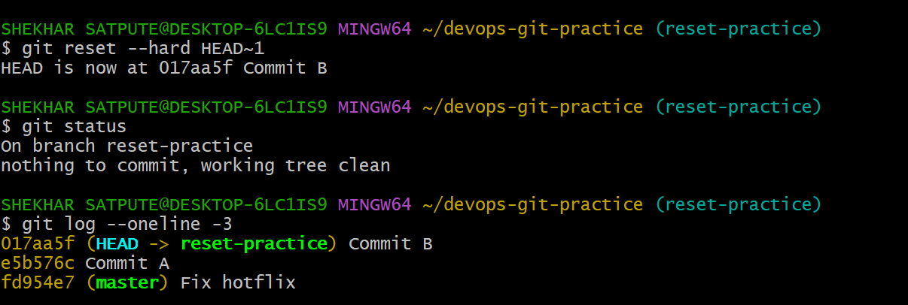
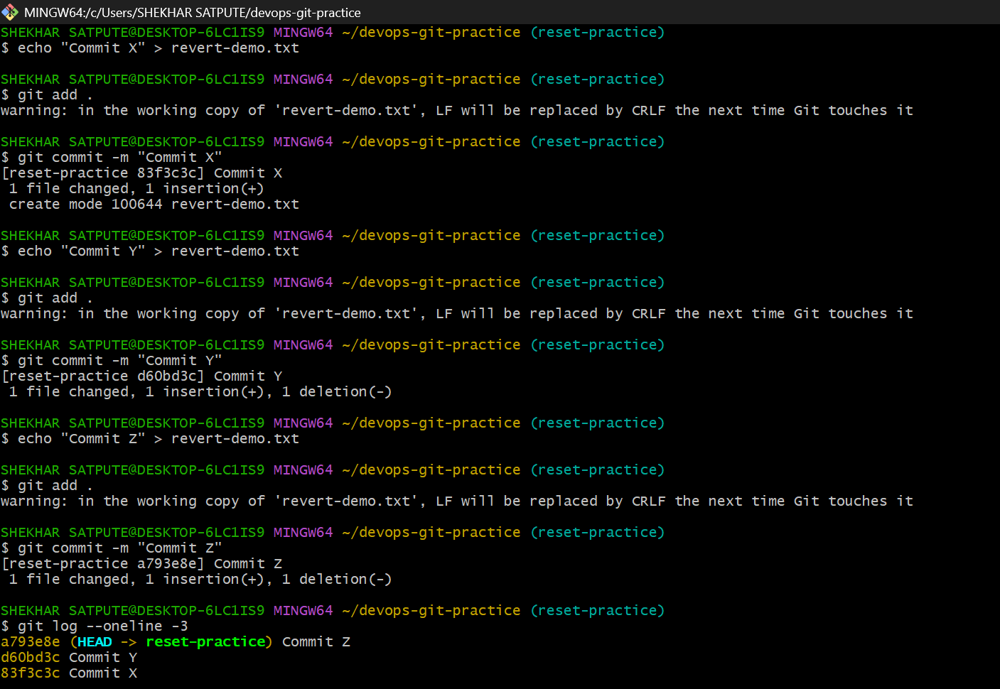
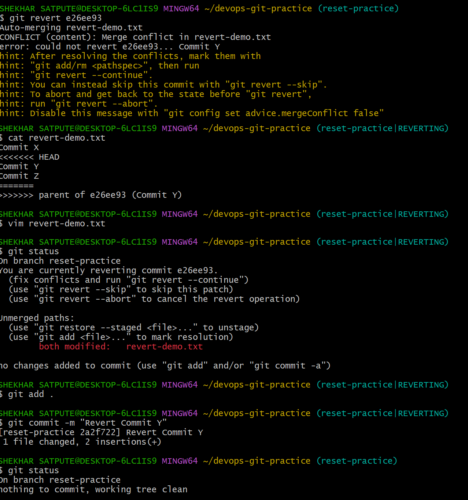
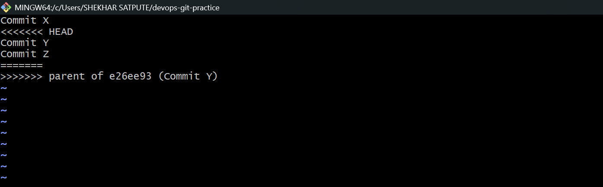
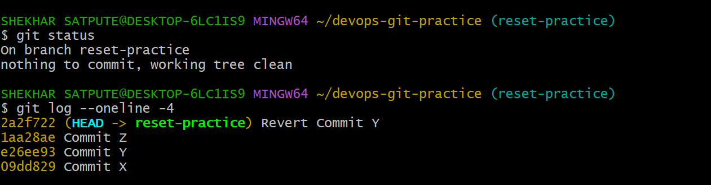

# Day 25 – Git Reset vs Revert & Branching Strategies

## Objective

Learn how to undo Git mistakes safely using `reset` and `revert`, and understand branching strategies used by development teams.

---

## Task 1: Git Reset — Hands-On

### 1. Create 3 commits in your practice repository (Commit A, B, C)

- Created three commits in the repository to understand how Git Reset affects commit history and file changes.



### 2. Use `git reset --soft` to go back one commit — what happens to the changes?

- Commit C was removed from the commit history.
- The changes from Commit C were preserved.
- The changes remained in the staging area and were ready to be committed again.




### 3. Re-commit, then use `git reset --mixed` to go back one commit — what happens now?

- Commit C was removed from the commit history.
- The changes were preserved in the working directory.
- The changes became unstaged and required staging before committing again.




### 4. Re-commit, then use `git reset --hard` to go back one commit — what happens this time?

- Commit C was removed from the commit history.
- All changes associated with Commit C were discarded.
- The repository returned to the previous commit state.
- The working tree became clean.



---

### Key Takeaways

### Q.1 What is the difference between `--soft`, `--mixed`, and `--hard`?

| Reset Mode | Commit Removed | Changes Kept | Staged |
|------------|----------------|-------------|---------|
| `--soft` | Yes | Yes | Yes |
| `--mixed` | Yes | Yes | No |
| `--hard` | Yes | No | No |

### Understanding Reset Options

| Option | What happens to changes? |
|---|---|
| `--soft` | Changes remain staged |
| `--mixed` | Changes remain unstaged in the working directory |
| `--hard` | Changes in the index and working directory are discarded |

### Q.2 Which one is destructive and why?

- `git reset --hard` is destructive because it permanently removes both the commit and its associated changes.

### Q.3 When to Use Each

- **Soft:** When I want to undo a commit but keep its changes staged for a new commit.
- **Mixed:** When I want to undo a commit and review or modify its changes before staging again.
- **Hard:** When I want to completely discard unwanted changes.

### Q.4 Should you ever use `git reset` on commits that are already pushed?

Generally No, avoid resetting commits that have already been pushed and shared with others. Reset rewrites branch history, which can cause problems for collaborators. Use `git revert` instead for shared branches.

---

## Task 2: Git Revert — Hands-On

### 1. Create 3 commits in the practice repository (Commit X, Y, Z)

- Created three sequential commits to understand how Git Revert works on existing commit history.
- Verified the commit order as Commit X → Commit Y → Commit Z.



### 2. Revert Commit Y (the middle commit)

- Attempted to revert Commit Y while Commit Z existed on top of it.
- Git detected a merge conflict because the changes from Commit Y were also referenced by later commits.
- Resolved the conflict manually and completed the revert operation.





### 3. Check the commit history

- Git created a new commit named **Revert "Commit Y"**.
- The original Commit Y was not removed from history.
- Revert preserved the commit history while undoing the changes introduced by Commit Y.



---

### Key Takeaways

#### Q.1 How is `git revert` different from `git reset`?

| Git Revert | Git Reset |
|------------|-----------|
| Creates a new commit that undoes previous changes | Moves the branch pointer to an earlier commit |
| Preserves commit history | Can rewrite commit history |
| Safe for shared repositories | Better suited for local history cleanup |

#### Q.2 Why is revert considered safer for shared branches?

- `git revert` does not remove or rewrite existing commits.
- Team members can continue working without history conflicts.
- It maintains a complete audit trail of changes.

#### Q.3 When would you use revert vs reset?

- **Git Revert** → When undoing changes that are already pushed or shared with a team.
- **Git Reset** → When cleaning up local commits before sharing them with others.

---

## Task 3: Reset vs Revert

| Feature | `git reset` | `git revert` |
|----------|-------------|--------------|
| **What it does** | Moves the current branch pointer to an earlier commit | Creates a new commit that reverses an earlier commit |
| **Removes commit from history?** | Yes, commits after the target are no longer on that branch  | No, commits after the target are no longer on that branch |
| **Rewrites history?** | Yes | No |
| **Safe for shared/pushed branches?** | No, Generally avoid because it rewrites history | Yes, generally safer |
| **Best use case** | Cleaning up local commits before pushing | Undoing changes that are already shared |

### Simple Workflow

```text
git reset:
A --- B --- C
          |
          reset to B
          |
A --- B

git revert:
A --- B --- C
          |
          revert B
          |
A --- B --- C --- R
```
- `R` is a new commit that reverses the changes introduced by B.

---

### Key Takeaways

- `git reset` modifies commit history and is best used on local branches.
- `git revert` preserves history and safely undoes changes through a new commit.
- For collaborative projects, `git revert` is the preferred approach.

---

## Task 4: Branching Strategies

### 1. GitFlow

GitFlow uses multiple long-lived branches for development and releases.

### How it works

- Uses separate branches for development, releases, and hotfixes.
- Features are developed in feature branches and merged into `develop`.
- Release branches are used to prepare production-ready versions before merging into `main`.

### Workflow

```text
main
 └── develop
      ├── feature/login
      ├── feature/signup
      ├── release/v1.0
      └── hotfix/v1.0.1
```

### When to Use

- Large development teams
- Enterprise applications
- Projects with planned release schedules

### Pros

- Clear separation of development and production code
- Well-structured release management
- Easier maintenance of multiple versions

### Cons

- More complex branching model
- Higher merge overhead
- Slower release process compared to modern workflows

---

### 2. GitHub Flow

GitHub Flow is a lightweight workflow built around one main branch and short-lived feature branches.

### How it works

1. Create a feature branch from `main`.
2. Make changes and commit them.
3. Push the branch to GitHub.
4. Open a pull request for review.
5. Merge the approved changes into `main`.
6. Deploy and delete the feature branch when finished.

### Workflow

```text
main
 ├── feature/login ──┐
 ├── feature/cart ───┤── Merge → main
 └── feature/ui ─────┘
```

### When to Use

- Web applications
- Small to medium-sized teams
- Continuous Deployment environments

### Pros

- Simple and easy to understand.
- Supports code reviews through pull requests.
- Encourages small changes and frequent releases.

### Cons

- Requires `main` to remain stable and tested.
- Needs good automated testing and deployment practices.
- Can become difficult with large release cycles

---

### 3. Trunk-Based Development

Trunk-Based Development is a workflow where developers integrate small changes into a shared main branch (the trunk) frequently.

### How it works

- Developers integrate changes into a single main branch frequently.
- Feature branches are short-lived.
- Small and frequent commits reduce integration issues.

### Workflow

```text
main (trunk)
 ├── bug fix
 ├── feature update
 ├── small improvement
 └── release
```

### When to Use

- DevOps and Platform teams
- CI/CD-driven environments
- SaaS products with frequent deployments

### Pros

- Fastest delivery cycle
- Fewer long-running branches
- Reduces merge conflicts
- Supports Continuous Integration

### Cons

- Requires strong automated testing
- Risky without a mature CI/CD pipeline

---

### Comparison

| Strategy | Best For | Complexity | Release Speed |
|-----------|-----------|------------|---------------|
| GitFlow | Large teams & scheduled releases | High | Medium |
| GitHub Flow | Small/medium teams | Low | High |
| Trunk-Based Development | DevOps & CI/CD teams | Medium | Very High |

---

### Answers

### Q.1 Which strategy would you use for a startup shipping fast?

- **For a startup shipping fast:** I would choose **GitHub Flow** because it is simple, supports pull requests, and enables frequent releases without managing multiple long-lived branches.

- **For teams practicing continuous integration and deployment:** I would consider **Trunk-Based Development**, which supports rapid development, frequent integration, and minimal branching overhead.

- **For large teams with scheduled releases:** I would consider **GitFlow** when the project requires formal release branches and maintenance of multiple versions.

### Q.2 Which strategy would you use for a large team with scheduled releases?

**GitFlow**
- Provides structured release management.
- Offers clear branch separation and better release control.

### Q.3 Which strategy does your favorite open-source project use?

**GitHub Flow**
- Commonly used by modern open-source projects on GitHub.
- Contributors work on feature branches, submit Pull Requests, and merge approved changes into `main`.

---

### Key Takeaways

Different teams require different branching strategies. 
- **GitFlow** is ideal for structured release management. 
- **GitHub Flow** simplifies collaboration and deployment.
- **Trunk-Based Development** enables rapid delivery through continuous integration. 

Selecting the right strategy depends on team size, release frequency, and deployment requirements.

---

## Task 5: Git Commands Reference

### Related Documentation

- [Git Commands Reference](git-commands.md)

---

# What I Learned

1. `git reset` moves the branch pointer, while `git revert` creates a new commit to reverse previous changes.
2. Revert is generally safer for shared branches because it preserves existing commit history.
3. GitFlow, GitHub Flow, and Trunk-Based Development provide different ways to organize collaboration and releases.

---